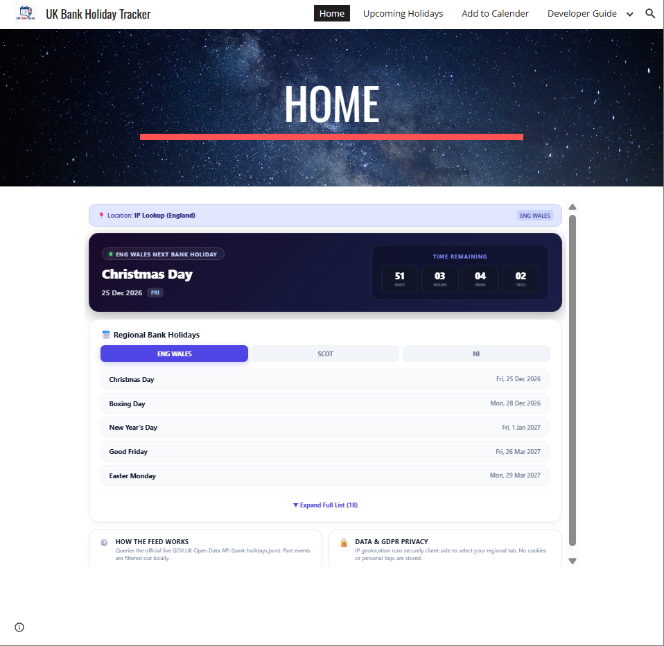

# UK Bank Holiday Tracker

A modern, location-aware web application and multi-platform companion designed to track UK bank holidays in real time across England & Wales, Scotland, and Northern Ireland.

---
##  Development & AI Disclosure
This project was developed and structured collaboratively with AI assistance (Gemini), combining modern frontend UI patterns, automated API integrations, and mobile widget architectures.
##  The Original Idea
 "I want to create a calendar widget to countdown the next bank holiday using the GOV.UK website and auto-change with the next one."
## How I Built It

I designed and built this project from the ground up to be lightweight, instant-loading, and completely serverless by leveraging modern web standards and public data feeds.

###  Architecture & Tech Stack
* **Frontend Core:** Pure **HTML5, CSS3, and Vanilla JavaScript**, structured into modular components embedded directly into a polished multi-page **Google Sites** portal (`https://sites.google.com/view/uk-holiday-tracker`).
* **Live Data Feed:** Automatically queries the official **GOV.UK Open Data API** (`bank-holidays.json`) on load. Past events are filtered out locally, and upcoming dates are parsed dynamically.
* **Smart Geolocation:** Integrated client-side IP lookup via **ipapi.co** with robust timeout guards and automatic fallbacks to instantly detect the user's region (**ENG WALES**, **SCOT**, or **NI**).

###  Key Features Developed
* **Live Countdown Banners:** Dark-mode gradient countdown timers that calculate real-time days, hours, minutes, and seconds until the next regional public holiday.
* **Multi-Region Navigation:** Clean, short regional abbreviation tabs (`ENG WALES`, `SCOT`, `NI`) with smooth active states.
* **Expandable Holiday Lists:** Scrollable container cards featuring a custom expandable view toggle (`▼ Expand Full List`) to keep the UI clean on both desktop and mobile viewports.
* **Calendar Syncing (`.ics` Generator):** A built-in utility that programmatically generates standard `.ics` calendar files on the fly, allowing visitors to download and sync schedules directly into Apple Calendar, Google Calendar, or Microsoft Outlook.
* **Developer Ecosystem:** Extended with custom native snippets for Android (`BankHolidayRepository.kt`, `GovUkApiService.kt`, `NextHolidayWidget.kt`) and iOS Scriptable widgets.

###  Privacy & Compliance
* Built with strict **GDPR compliance** in mind: location detection runs entirely client-side, and no personal identifiers, tracking cookies, or location logs are ever stored or shared.

---
## Preview

