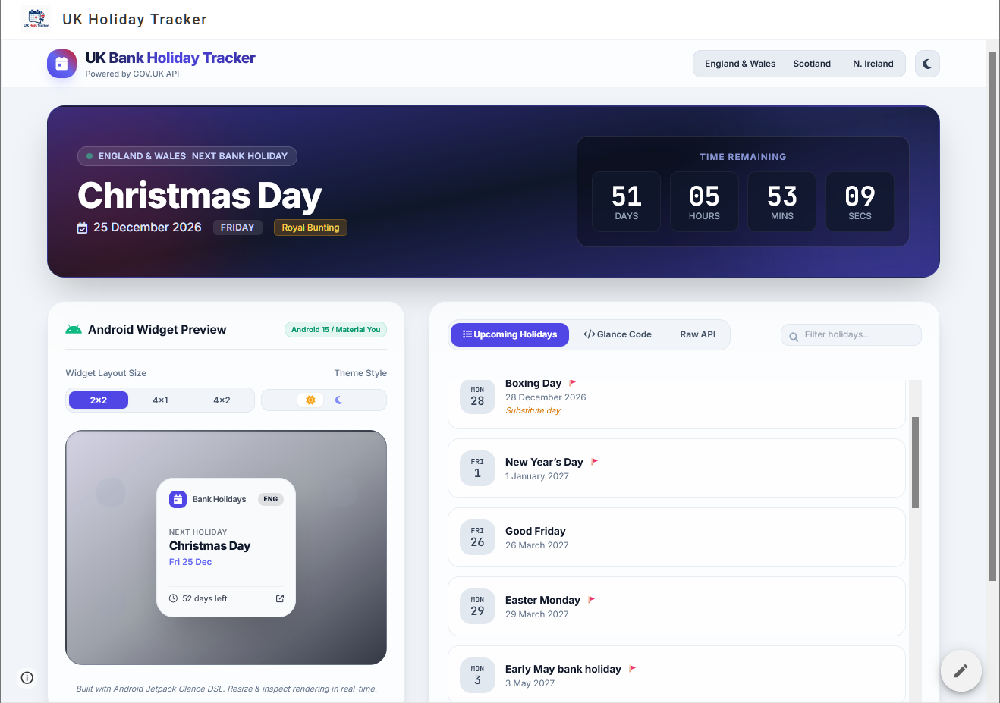

#  UK Hols Tracker (Android Jetpack Glance)

A modern Android widget and tracker built using Jetpack Glance and Retrofit, fetching real-time holiday data from the GOV.UK API.

##  Tech Stack
- Kotlin, Jetpack Glance, Retrofit, Gson, Coroutines.
## Live Site 
[Live Site] (https://sites.google.com/view/uk-holiday-tracker?usp=sharing)

## How I Built It

### 1. Architecture & Design Choices
- **Declarative Widgets with Jetpack Glance:** Instead of traditional XML layouts and `RemoteViews`, this widget is built using **Jetpack Glance**, allowing standard Jetpack Compose mental models and composables to render native home screen widgets with modern theming support (`GlanceTheme`).
- **Asynchronous Data Handling:** Network calls are offloaded using **Kotlin Coroutines** (`withContext(Dispatchers.IO)`) to ensure the background sync happens smoothly without blocking the main thread or causing ANRs (Application Not Responding).

### 2. Networking & Data Layer
- **Retrofit & Gson:** Built a type-safe API client targeting the official public GOV.UK endpoint (`https://www.gov.uk/bank-holidays.json`). 
- **Multi-Region Support:** Structured the data models (`GovUkResponse`, `DivisionData`, `BankHolidayEvent`) with `@SerializedName` annotations to map JSON nodes for England & Wales, Scotland, and Northern Ireland independently.

### 3. Algorithm: Finding the Next Upcoming Holiday
Using Java's modern `java.time` API (`LocalDate` and `DateTimeFormatter`), the repository filters and calculates the next holiday dynamically:
1. Fetches the complete JSON event list for the selected region.
2. Parses string dates (`yyyy-MM-dd`) into `LocalDate` objects.
3. Filters out any dates that occur before today (`!date.isBefore(today)`).
4. Selects the closest future date using `.minByOrNull { (_, date) -> date }`.

### 4. Web Companion Integration
Alongside the native Android widget, a lightweight HTML file (`index.html`) was created to host a full-screen responsive iframe embedding a live Google Sites companion dashboard (`https://sites.google.com/view/uk-holiday-tracker/full-page-embed`).

##  Widget Preview

